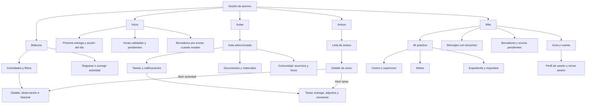

# PrácticasCC · Propuesta de navegación y trabajo en Figma

Estado: dirección visual y orden general aceptados por el usuario. El [incremento 21](INCREMENTO-21.md) integra las cinco pestañas y sus detalles en la sesión real de alumno, conservando los módulos y permisos existentes. La adaptación de los otros roles continúa después de la revisión del alumno en Android.

## Mapa del alumno para FigJam

Cada bloque principal es una pestaña. Los bloques siguientes son pantallas de detalle o grupos de opciones, no pestañas adicionales. El ingreso precede a este mapa y la demo mantiene su acceso separado.

La próxima entrega abre su tarea, registrar actividad abre su formulario y el resumen de horas abre la bitácora. Preparar entrega abre una pantalla propia dentro de la pestaña de origen; Atrás regresa a la tarea. Aula organiza Tareas, Notas y Recursos. Borradores permite retomar tanto actividades como respuestas de tareas. El expediente conserva su selección de práctica cuando corresponda. Ver [incremento 23](INCREMENTO-23.md).

El [incremento 25](INCREMENTO-25.md) completa la presentación interior de Centro y supervisor, Metas y Expediente. Desde el expediente se abre la práctica exacta en metas y se puede volver conservando los detalles desplegados; la bitácora corresponde a su pestaña principal. El resumen del expediente omite el historial completo y el PDF se solicita al descargarlo. La versión de presentación del 23 de octubre está separada de este desarrollo.

El [incremento 26](INCREMENTO-26.md) adapta Mensajes/Conversación, Comunidad/Foro/Anuncio, Documentos, Borradores y Guía. Los accesos conservan la pestaña de origen. Abrir un anuncio descarga su texto individual; las conversaciones consultan mensajes recientes y anteriores por páginas. Los formularios de comunicación permiten guardar y volver y retomar su borrador desde Más. Las listas de documentos distinguen materiales y cargas propias; descargar, subir y confirmar una entrega son acciones diferentes.

## Esqueleto de los cuatro roles

| Rol | Destinos principales propuestos | Organización interior |
| --- | --- | --- |
| Alumno | Inicio · Bitácora · Aulas · Avisos · Más | Mapa anterior. |
| Docente | Inicio · Aulas · Seguimiento · Avisos · Más | Aula: tareas, entregas, notas, asistencia académica, materiales y comunidad. Seguimiento por aula/alumno con acceso a metas y expediente. Más: mensajes, guía y cuenta. |
| Supervisor | Inicio · Practicantes · Horas · Avisos · Más | Practicantes vinculados: evaluación y expediente. Horas: revisión e historial. Más: metas de sus prácticas, guía y cuenta. |
| Administración | Inicio · Gestión · Reportes · Avisos · Más | Gestión: usuarios/roles, aulas/matrículas, asignaciones/supervisores, auditoría y operaciones docentes/expedientes autorizadas. Más: guía y cuenta. |

Son agrupaciones de presentación. Las pantallas que necesitan aula, alumno o práctica deben ofrecer primero esa selección; no se presupone un endpoint global nuevo. Los datos y las acciones siguen limitados por los permisos del servidor. La mensajería privada corresponde a alumno/docente; el supervisor no autoriza el cierre.

## Prioridad y búsquedas por rol

La aplicación contempla los cuatro roles, con interfaces según sus responsabilidades. Primero se completa e integra el recorrido del alumno; después se adapta la experiencia docente y se extiende el diseño a supervisor y administración. La prioridad de diseño no elimina sus funciones existentes.

- **Alumno:** sin campos de búsqueda de texto en las listas de esta primera etapa. Mostrar su contenido directamente: bitácora por fecha descendente y filtros de estado, tareas por plazo y aulas activas claramente identificadas. Conservar el contexto y evitar controles que no aporten a su recorrido.
- **Docente:** incorporar búsqueda donde gestiona volumen, como alumnos, matrículas y entregas, dentro del aula o ámbito autorizado. Combinarla con filtros de revisión; no añadir un buscador a cada pantalla por defecto.
- **Supervisor y administración:** su adaptación visual se aborda después. No extender automáticamente los controles del docente al resto de roles.

## Carga ligera de listas

La integración Expo debe pedir bloques acotados al servidor, ordenados con un desempate estable por identificador. Aplicar filtros en el servidor, conservar la posición y las filas ya cargadas al abrir un detalle, y renderizar solo las filas necesarias. La siguiente carga debe añadir registros sin duplicarlos ni desplazar al usuario al comienzo. Un fallo al traer más datos conserva lo visible y ofrece reintento.

Los totales de horas y los contadores se calculan sobre el conjunto autorizado completo, no sobre la página visible. Cargar cada módulo al abrirlo y descargar los archivos solo cuando se soliciten. Bitácora, Avisos y las tareas/notas del aula ya aplican paginación real de 20 filas, filtros en servidor y `FlatList`; otras listas conservan sus API actuales. Abrir una tarea consulta su detalle individual; el historial se solicita aparte. Quitar un campo de búsqueda por sí solo no reduce los datos descargados.

Desde el incremento 26, el alumno también usa páginas reales de 20 para mensajes, temas/respuestas, anuncios y documentos. Los anuncios devuelven extractos y su detalle individual; listar documentos no descarga bytes. Metas y listado de prácticas aún usan sus consultas completas. Las vistas de los otros roles conservan sus API actuales hasta su adaptación.

El prototipo HTML muestra ocho actividades iniciales y permite consultar las anteriores en bloques de ocho. Usa datos ficticios que ya están en memoria: demuestra el orden y la presentación progresiva, no paginación de red ni mejoras de rendimiento medidas.

## Comportamientos que debemos dibujar y comprobar

1. Cada pestaña conserva filtros, posición e historial al cambiar de sección.
2. Un acceso desde Inicio o Avisos tiene un destino y un retorno definidos. Al abrir una tarea desde un aviso, registrar de dónde se abrió y comprobar Atrás; no asumir que todos los enlaces vuelven automáticamente al origen.
3. Un formulario permite guardar borrador o confirmar antes de descartar cambios. El teclado no impide editar ni alcanzar la acción final.
4. Un envío distingue contenido local, envío en curso, recibido y error. Los borradores confirmados se envían mediante la acción explícita existente.
5. Una práctica sin asignación, un aula vacía, una sesión vencida o un permiso retirado muestran un estado comprensible y una salida útil.
6. Los avisos nuevos de tarea o revisión de horas abren su recurso exacto dentro de la pestaña Avisos; Atrás regresa al aviso y a su bandeja. El [incremento 22](INCREMENTO-22.md) añade esos identificadores y conserva los avisos antiguos como informativos, sin reconstruir destinos. Consultar no marca leído automáticamente. Las acciones importantes incluyen la revisión o confirmación correspondiente.

## Primer recorrido visual

Base propuesta: `Inicio-Pr-xima-tarea-primero.png`, con resumen compacto de `Inicio-Avance-primero.png`. Mantener el orden estable: cabecera, próxima entrega, registrar actividad, horas y pendientes relevantes. Corregir unidades partidas, fechas repetidas y accesos redundantes. El avance hacia la meta usa horas validadas; una distribución de registradas no equivale al cumplimiento de la meta.

Primeras seis pantallas para desarrollar con un mismo sistema visual: **Inicio, Bitácora, Registrar actividad, Aulas, Detalle de tarea y Más**. Preparar además los estados de carga, vacío, error y borrador de esos recorridos. Después extender a ingreso, avisos y módulos secundarios; los otros roles reutilizan componentes y conservan sus diferencias de responsabilidad.

## Trabajo compartido

**El usuario aporta referencias y criterio:** elegir hasta seis capturas o enlaces, con una frase por referencia que explique qué le resulta claro o atractivo. Las dos propuestas de Inicio ya cuentan como dirección visual, así que las referencias nuevas deben ayudar principalmente con navegación y estados interiores.

En Mobbin, buscar tres pares de referencias:

| Buscar | Qué necesitamos observar |
| --- | --- |
| `navigation`, `profile`, `settings` | Navegación inferior y una pantalla de Más/Cuenta con secciones comprensibles. |
| `activity`, `task list`, `filter` | Lista de actividades/tareas y filtros que no oculten el contexto. |
| `form`, `task details`, `confirmation` | Formulario largo con teclado y un detalle/envío con estado claro. |

**Codex prepara y adapta:** inventario de pantallas, mapa por roles, componentes reutilizables y conexión al flujo existente. Las referencias orientan el diseño; las decisiones de agrupación se revisan con los recorridos reales.

## Archivos de Figma sugeridos

- FigJam: **PrácticasCC · Navegación**, con cuatro secciones por rol; comenzar por el mapa de alumno anterior.
- Figma Design: **PrácticasCC · Diseño móvil**, con tres páginas: **Referencias**, **Componentes** y **Pantallas**.
- Referencias: colocar las dos imágenes de Inicio y las capturas elegidas, anotando qué se toma de cada una. Las imágenes son referencia; los controles del diseño se construyen como capas editables.
- Componentes: granate `#5E151D`, textos, espaciados y variantes de campos, acciones, etiquetas de estado, filas, tarjetas y navegación. Seguir los requisitos móviles del brief.
- Pantallas: conectar primero los seis destinos del recorrido visual y sus estados. Comprobar en el teléfono textos largos, fuente ampliada, teclado y botón Atrás.

La integración de Figma debe estar instalada y autorizada antes de usar herramientas sobre la cuenta del usuario. Un enlace por sí solo no confirma acceso. Si no hay conexión, este documento permite continuar el mapa y revisar capturas/exportaciones.

## Comprobación con usuarios

Pedir a un alumno que encuentre y complete, sin explicarle dónde tocar: registrar actividad; corregir una rechazada; localizar y entregar una tarea; retomar un borrador; consultar requisitos del expediente. Observar el primer destino que elige, desvíos y si comprende el estado final. Ajustar nombres y agrupaciones a partir de esos resultados.

Fuentes: [FigJam](https://www.figma.com/figjam/), [prototipos en Figma](https://help.figma.com/hc/en-us/articles/360040314193-Guide-to-prototyping-in-Figma), [Mobbin](https://mobbin.com/). Complemento: [brief de diseño](BRIEF-DISENO-REPLIT.md).
